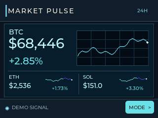
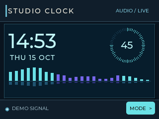
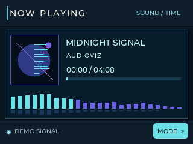
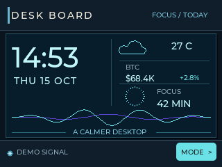

<p align="center">
  
</p>

<h1 align="center">AudioViz PC</h1>

<p align="center">
  A lightweight desktop music visualizer for Windows, Linux and macOS.<br>
  Turn your system audio into polished spectrum, waveform and VU views.
</p>

<p align="center">
  <a href="https://github.com/tungat-tech/audio-viz-pc/releases/latest"></a>
  <a href="LICENSE"></a>
  
</p>

<table>
  <tr>
    <td width="33%"></td>
    <td width="33%"></td>
    <td width="33%"></td>
  </tr>
  <tr align="center">
    <td><b>Halo</b></td>
    <td><b>Aurora Weave</b></td>
    <td><b>Cymatic Mesh</b></td>
  </tr>
</table>

## Download

Choose the build for your computer from the
**[latest release](https://github.com/tungat-tech/audio-viz-pc/releases/latest)**:

| Platform | Download | Notes |
| --- | --- | --- |
| Windows x64 | [EXE](https://github.com/tungat-tech/audio-viz-pc/releases/latest/download/AudioViz-PC-Windows-x64.exe) · [ZIP](https://github.com/tungat-tech/audio-viz-pc/releases/latest/download/AudioViz-PC-Windows-x64.zip) | Captures the default output with WASAPI loopback |
| Linux x64 | [Executable](https://github.com/tungat-tech/audio-viz-pc/releases/latest/download/AudioViz-PC-Linux-x64) · [tar.gz](https://github.com/tungat-tech/audio-viz-pc/releases/latest/download/AudioViz-PC-Linux-x64.tar.gz) | Uses the default PulseAudio/PipeWire monitor |
| macOS Apple Silicon | [.app.zip](https://github.com/tungat-tech/audio-viz-pc/releases/latest/download/AudioViz-PC-macOS-arm64.app.zip) | Requires a loopback input such as BlackHole |
| macOS Intel | [.app.zip](https://github.com/tungat-tech/audio-viz-pc/releases/latest/download/AudioViz-PC-macOS-x64.app.zip) | Requires a loopback input such as BlackHole |

Checksums are published as
[`SHA256SUMS.txt`](https://github.com/tungat-tech/audio-viz-pc/releases/latest/download/SHA256SUMS.txt).
The current macOS builds are unsigned, so first launch may require
**Right-click → Open** in Finder.

## Use it

Start the app and play music normally. AudioViz opens in **Now Playing** mode.

- Click **STYLE** to cycle through visual styles.
- Click **MODE** or press **Space** to switch between the five main displays.
- Press a number from **1** to **5** to jump directly to a display.
- Use `--demo` to explore the interface without an audio source.

Spectrum includes Bars, Trace, Dots, Pulse, Mirror, Waveform, Scope, Halo,
Waterfall, Ridgeline, Topo Bloom, Aurora Weave and Cymatic Mesh. The warm VU
display is temporarily hidden from the main navigation.

The utility displays add Market Pulse, Studio Clock, Now Playing and Desk
Board. Market Pulse and the Desk Board fetch public BTC, ETH and SOL market
data from Binance every 5 seconds; no account or API key is required. Desk
Board gets current temperature from Open-Meteo, using Hanoi by default. On
Windows, Now Playing reads the active system media session exposed by players
such as Spotify, VLC and supported browsers. It displays the current album art,
falls back to the AudioViz logo when artwork is unavailable, scrolls long title
and artist fields inside their panel, and includes Vietnamese glyph coverage.
Studio Clock uses your computer's local time. `--demo` never contacts the
network and uses deterministic preview values.

## Utility displays

<table>
  <tr>
    <td width="25%"></td>
    <td width="25%"></td>
    <td width="25%"></td>
    <td width="25%"></td>
  </tr>
  <tr align="center">
    <td><b>Market Pulse</b></td>
    <td><b>Studio Clock</b></td>
    <td><b>Now Playing</b></td>
    <td><b>Desk Board</b></td>
  </tr>
</table>

## More visual styles

<table>
  <tr>
    <td width="33%"></td>
    <td width="33%"></td>
    <td width="33%"></td>
  </tr>
  <tr align="center">
    <td><b>Waterfall</b></td>
    <td><b>Ridgeline</b></td>
    <td><b>Topo Bloom</b></td>
  </tr>
  <tr>
    <td width="33%"></td>
    <td width="33%"></td>
    <td width="33%"></td>
  </tr>
  <tr align="center">
    <td><b>Bars</b></td>
    <td><b>Pulse</b></td>
    <td><b>Halo</b></td>
  </tr>
</table>

## Audio capture notes

- **Windows:** no extra setup is normally required. The app follows the default
  system playback device through WASAPI loopback.
- **Linux:** the app selects the monitor of the default PulseAudio/PipeWire
  output when available.
- **macOS:** macOS has no built-in system-output loopback device. Install a
  virtual input such as BlackHole, then select it with
  `--audio-device "DEVICE NAME"`.

## Command-line options

```text
AudioViz_PC --demo
AudioViz_PC --list-audio-devices
AudioViz_PC --audio-device "device name"
AudioViz_PC --weather-city "Ho Chi Minh City"
AudioViz_PC --demo --mode 1 --style 6
AudioViz_PC --screenshot output.bmp --frames 60
```

Modes are `1` Now Playing, `2` Spectrum, `3` Studio Clock, `4` Market Pulse and
`5` Desk Board. Spectrum styles use indices `0` through `12` in the order
listed above.

Weather is refreshed every 15 minutes. Use `--weather-city "CITY"` to override
the default Hanoi location. The app keeps the last successful market/weather
snapshot and marks it stale when a refresh fails. Now Playing is currently live
on Windows; Linux and macOS retain the no-session fallback.

## For developers

AudioViz PC uses C++17, SDL2, LVGL and miniaudio. The shared UI Core is included
under `libs/audioviz-ui`; third-party dependencies are pinned and downloaded
automatically during the first configure.

<details>
<summary><b>Build on Windows</b></summary>

Install Visual Studio 2022 with **Desktop development with C++** and CMake 3.21+.
From a Developer PowerShell:

```powershell
./build_windows.ps1
```

</details>

<details>
<summary><b>Build on Linux or macOS</b></summary>

Install CMake 3.21+, Ninja and a C/C++ compiler, then run:

```bash
./build_unix.sh
```

Linux additionally needs the usual SDL development packages and PulseAudio
headers plus libcurl development headers. The macOS build uses the system curl
library and produces `build/AudioViz_PC.app`.

</details>

Every push and pull request is built and smoke-tested on Windows x64, Linux x64,
macOS Apple Silicon and macOS Intel through GitHub Actions.

## Project scope and license

This repository contains the open-source desktop visualizer only. It does not
contain ESP32 firmware, device protocol, serial transport, flashing tools or
board calibration.

AudioViz PC is MIT-licensed. Third-party components retain their own licenses;
see [THIRD_PARTY.md](THIRD_PARTY.md). No purchase or external device is required
to use the desktop visualizer.

Halo is an original CPU-rendered view inspired by the general circular spectrum
idea in [Jasper Bernaers' music visualizer](https://jasperbernaers.com/music-visualizer/).
It uses AudioViz's own spectrum and waveform renderer.
